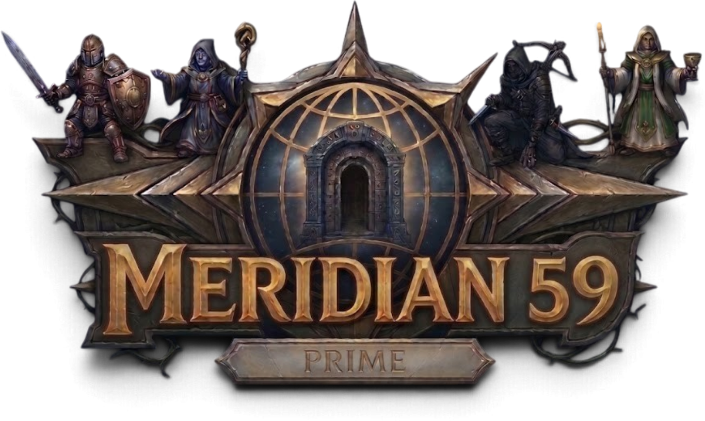

# Meridian 59 Prime

<p align="center"></p>

**Meridian 59 Prime** is a custom edition of the classic online RPG *Meridian 59*: the Server 104 game (64-bit, built for Linux) played in a web browser, with our own class system, groups, companions, living towns full of **playerbots** that walk, hunt, talk and greet you, and smarter monsters.

It is a non-commercial fan project. It is built as **a pinned upstream + small numbered patches + our own files**, so upstream updates can be pulled in without losing our work.

## What is different from the original

- **Classes:** Warrior, Monk, Paladin and Elementalist, each with a six-level ability table, class trainers, class-specific rules and rebalanced gear. A rule switches back to the original classless characters.
- **Groups and companions:** groups of up to five (players, bots and companions), shared health and mana window, no friendly fire, shared XP and heals. Companion bots are built from the player's own numbers and fight what the player fights.
- **Playerbots:** a living population of characters (50 online by default, you choose how many) that appear in *who* with gamer handles or human names (a rule), log in and out, hang about the towns and inns, shop, travel by the town portals and **really walk** the world: they plan a path over each room's real floor, go round creatures, fight what they can beat, flee from what they can't, hunt real monsters, die and come back through the underworld. In the towns they stand on their own square, look at who is near, talk to each other face to face, say townsfolk lines now and then, and wave and say hello to players (each of these has a rule to switch it off). Their disciple robes show their class level.
- **Smarter monsters:** line-of-sight aggro, a leash for chases that get nowhere, and aggro only where a walking route exists.
- **Admin tools:** an in-game admin console (travel, items, creatures, weather), a terminal admin tool with every game and bot rule, and a set of debugging tools that show what any bot is doing and why, test its journeys and measure its cost (`claude_tools/`).
- **Web client:** class picker, group and companion windows, monster health bars, floating damage and heal numbers, a new title screen, settings that apply as you change them, and a sound button on the login screen. An Electron launcher is included.
- **Server fixes:** a 64-bit Linux build, MD5 fixed on 64-bit, no silent death when a client disconnects, real account deletion on Linux, rooms and monsters that never loaded on Linux because of capital letters in file names, and `show status` that no longer hangs.

The full list is in [wiki/FEATURES.md](wiki/FEATURES.md); every change is numbered in [wiki/changes.txt](wiki/changes.txt).

## Quick start (one script, needs distrobox)

You need Linux, **[distrobox](https://distrobox.it)** with podman or docker, and curl. Nothing else; the build tools are installed inside the box, and your own home folder is not touched.

```bash
git clone https://github.com/catastrophic-impact/m59-prime
cd m59-prime
./m59primesetup.sh
```

The script creates an Ubuntu 22.04 distrobox called `m59-box` with its own home in `~/boxes/m59-box`, builds the server and the web client, downloads the game files (see below), and puts everything in one portable folder, **`release/`**. The first run takes 20 to 40 minutes. Copy `release/` anywhere, then inside it:

```bash
./start-server.sh     # the first start prints the admin password once
./start-client.sh     # then open the printed address in a browser
./stop-all.sh         # saves the game and stops everything
```

Options: `--name` (another box name), `--release DIR` (another output folder), `--assets-from DIR` (use game files you already have), `--assemble-only` (rebuild only the release folder). `./m59primesetup.sh --help` lists them. Building by hand without distrobox is described in [docs/BUILDING.md](docs/BUILDING.md).

### The game files are not included

The art, sounds and rooms belong to the original game's owners and the people who made the Server 104 additions. They are **not** in this repository. The setup script downloads one pinned release of Meridian Shards on your own computer, checks its SHA-256 and unpacks the game files from it (`prime_client/ASSETS.txt`). Please respect the rights of the owners.

## What is in this repository

| Folder | What |
|---|---|
| `prime_server/` | The game server: pinned upstream (`UPSTREAM.txt`), numbered `patches/`, our own `overlay/` (Blakod classes, bots, rules) and the `scripts/` that build and run it |
| `prime_client/` | The web client: pinned upstream, `patches/`, `overlay/`, `scripts/`, and `ASSETS.txt` (the pinned download of the game files) |
| `prime_release/` | The start, stop and admin scripts and the small web server that go into the portable `release/` folder |
| `claude_tools/` | Tools to watch, test and debug the playerbots and the room maps (see its `README.md`) |
| `docs/` | Build instructions, design notes, the world map and bot data |
| `wiki/` | Feature list and the numbered change log |
| `custom_assets/` | Our logo |

## Licence

GNU General Public License v2 (see [LICENSE](LICENSE)), like the Meridian 59 source it grows from. *Meridian 59* is a registered trademark of its owners; this project is not the official game and is not affiliated with them.

## Thank you

This project stands on the work of others, and we are grateful to them:

- **[Meridian Shards](https://github.com/jboullion/meridian-shards)**: the web client our client is built on, and the source of the packaged game files.
- **[Server 104 / shards-server](https://github.com/jboullion/shards-server)**: the server our server is built on.
- **[Meridian 59](https://github.com/Meridian59/Meridian59)**: the original game by Andrew Kirmse and Chris Kirmse, released as open source in 2012 and kept alive by the Open Meridian community. None of this would exist without it.

See [NOTICE.md](NOTICE.md) for the full credits.
